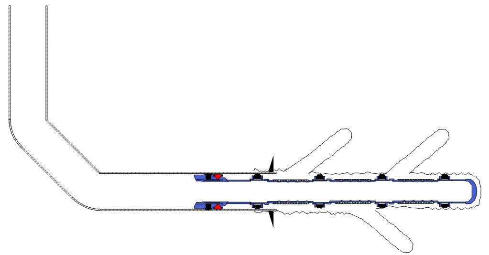
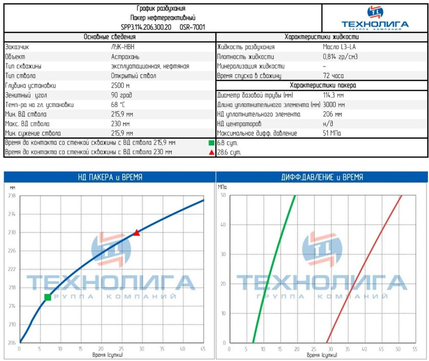

### 1 Краткое описание.  
* Безопасное и эффективное проведение работ по спуску и установке нижнего заканчивания скважины согласно требованиям нормативной документации по промышленной безопасности РФ, компаний ООО "ЛУКОЙЛ- Нижневолжскнефть", АФ ООО "СПЕЦПРОМСЕРВИС", "Везерфорд", и "Шлюмберже", является основной задачей данного плана работ. Соответствие международным стандартам безопасности, охраны окружающей среды и качества - наша первостепенная задача.
  
### 2 Состояние скважины
 
 Табл. 1. Конструкция скважины
 

 |
Название скважины
| 
36
  |
 |:-----------------------------|-----------------------:|  
 |  Тип скважины:                |  Эксплуатационная       |
 |Информация по обсадной колонне:|244,5 мм х 11,99 мм (69,94 КГ/М) L80 TMK UP PF
 |Глубина спуска ЭК|280.5 м|
 Глубина скважины по стволу|5220.00 м (плановое значение)

  
Спустить компоновку через роторный стол и посадить верхний патрубок на клинья. АФ "СПЕЦПРОМСЕРВИС", Везерфорд.  
>__Примечание:__  
>  * __Прохождение компоновок и хомутов через пневматические  клинья производить со скоростью не более чем 3 м/мин.__  
>  * __Прохождение компоновок через райзерную систему,  превентор и устье скважины производить со скоростью не более чем 3 м/мин.__  
  
   __Примечание:__  
   * __Прохождение компоновок и хомутов через пневматические  клинья производить со скоростью не более чем 3 м/мин.__  
   * __Прохождение компоновок через райзерную систему,  превентор и устье скважины производить со скоростью не более чем 3 м/мин.__

### 5. Состояние скважины перед спуском НКТ и ВСО Верхнего Заканчивания.
5.1 Эксплуатационная колонна 244.5 мм.  
* Установлена моноблочная колонная головка WEFIC.  
* Произведен каротаж обсадной колонны (локатор муфт обсадной колонны).
* Колонна опрессована на 16,4 МПа.

5.2 Раствор
* При спуске верхнего заканчивания в скважине находится солевой раствор CaCl2 с удельным весом 1,16 г/см3.  

### 6. Подготовительные работы к спуску ВСО верхнего заканчивания.  
#### 6.1 Общие требования  
   Трубы  
6.1.1  Все трубы и патрубки размером 114.3 мм должны быть размещены на трубной палубе в порядке спуска в скважину. Ответственность: АФ ООО "СПЕЦПРОМСЕРВИС", "ЛУКОЙЛ-Нижневолжскнефть".
6.1.2 Все трубы и патрубки размером 114.3 мм должны быть прошаблонированы, измерены и на каждую нанесен порядковый номер. Ответственность: АФ ООО "СПЕЦПРОМСЕРВИС", "ЛУКОЙЛ-Нижневолжскнефть".  
Таьлица 1. - Момент свинчивания НКТ
|__
Момент свинчивания
__|__
114.3 х 6.88 мм ТМК Up Centrum ET, P-110 Н*м/футо-фунт
__| 
|:----------|:-----------:| 
|__Минимальный__|5000/3700|  
|__Оптимальный__|5500/4100|  
|__Максимальный__|6000/4400|  

Рисунок 1. Диаграмма скважины при установке хвостовика в основной ствол.  
  

### 3 Подготовительные работы  
#### 3.1 Предшествующие операции.  

* Зафиксировать все возникающие при бурении и проработке открытого ствола осложнения, интервалы посадок/затяжек.  
__Ответственность:__ Инженер ЦСБ ООО "ЛУКОЙЛ-Инжиниринг", представитель АФ ООО "СПЕЦПРОМСЕРВИС"
* При подъеме компоговки после проработки открытого ствола в вертикальной части ствола произвести проверку и, при необходимости, калибровку датчика веса.
__Ответственность:__ представитель АФ ООО "СПЕЦПРОМСЕРВИС"
* Зарегистрировать вес компоновки на бурение при движении вверх/вниз на забое и в интервале предположительной установки головы хвостовика (без вращения). Зарегистрировать свободный момент вращения транспортной колонны 10 об/мин, и вес на глубине установки головы хвостовика.  
__Ответственность:__ инженер ННБ "Шлюмберже", инженер по заканчиванию "Шлюмберже", представитель Заказчика на буровой.
* Опрессовать линии ЦА на 340 атм. Убедиться, что ЦА готов к цифровой записи процесса активации гидравлического оборудования.  
  

### 4 Детальная программа нижнего заканчивания  
__4.1 Сборка и спуск__  
4.1.1 Перед началом спуска Нижнего заканчивания провести совещание.
> План совещания:  
> * Ознакомление с программой всех принимающих участие в спуске
> * Рассмотрение согласованной схемы Нижнего заканчивания
> * Определение нестандартных операций и связанных с ними рисков
> * Рассмотрение ролей и ответственности по ключевому персоналу
> * Рассмотрение методов коммуникации на буровой палубе и прочих зонах, задействованных в операции
> * Рассмотрение процедур предупреждения ГНВП
> * "Карта параметров спуска Нижнего заканчивания", необходимость ее соблюдения.  
> __Ответственность:__ инженер по заканчиванию "Шлюмберже", представитель Заказчика на буровой.    

4.1.2 Перед началом работ по спуску хвостовика произвести подготовку бурового комплекса к монтажу оборудования компании "Везерфорд" для снижения временных затрат по установке во время спуска хвостовика.  
__Ответственность:__АО ООО "СПЕЦПРОМСЕРВИС", инженер "Везерфорд", представитель Заказчика на буровой.  
4.1.3 Закрыть глухие плашки ПВО. Поднять башмачную компоновку №1 на ротор.  
__Ответственность:__представитель АФ ООО "СПЕЦПРОМСТРОЙ", инженер по заканчиванию "Шлюмберже".  
4.1.4 Спустить компоновку №1 ниже стола ротора.  
__Ответственность:__представитель АФ "СПЕЦПРОМСЕРВИС", инженер по заканчиванию "Шлюмберже".  
*Таблица 7. Компоновка №1.*  
|Описание  |Размер/Тип резьбы|Длина, м|
|:---------|:---------------:|-------:|
Патрубок, 5 м.| 114.3 мм TMK UP MOMENTUM GT муфта х нипель | 5.00
Башмак 114.3 мм| 114.3 мм TMK UP MOMENTUM GT муфта | 0.48

> __Примечание:__ Длина компоновки в данном документе предоставленна согласно документации оборудования; фактическая длина будет представлена после физического подтверждения длин.  

4.1.5 Навернуть на компоновку №1 последовательно три обсадных трубы 114.3 мм без установленных на них центраторов.  
__Ответственность:__ представитель АФ ООО "СПЕЦПРОМСЕРВИС", инженер по заканчиванию "Шлюмберже", инженер "Везерфорд".  
> __Примечание:__ 
> * Подъем фильтров 114.3 мм на роторный стол производить краном.

### Приложние №1  
#### Нештатные ситуации при спуске заканчивания (все действия по нештатным ситуациям должны согласовываться с офисом)  
__Высокое давление при промывке:__  
* Циркуляцию всегда начинать плавно, начиная с минимальной производительностью насоса (100 л/мин);
* Остановить циркуляцию при повышении давления свыше 60 атм на стояке;
* Стравить давление
* Расходить колонну и попробовать заново  

### Приложение №3 График разбухания 114.3 мм пакеров (нефть)  
 
